 

  

  <picture>
    <source media="(prefers-color-scheme: dark)" srcset="assets/tags-dark.svg">
    
  </picture>

  

<h3 align="center">Understand the universe.</h3>

That's the mission. Everything else is a subroutine.

<h3 align="center">Make it curious. Make it honest.</h3>

That's the whole safety plan.

<h3 align="center">Photons in, actions out.</h3>

No rules. Just physics and gradients.

<h3 align="center">Chatbots are cute.</h3>

Humanoid robots will be the biggest product in history. Not even close.

<h3 align="center">10X a year.</h3>

Rate of improvement is all that matters. Plan accordingly.

<h3 align="center">99% of AI demos are 1% product.</h3>

Prototypes are easy. Production is hard.

<h3 align="center">Abundance for all. Work optional.</h3>

The future is going to be wild. 🚀

  

 
